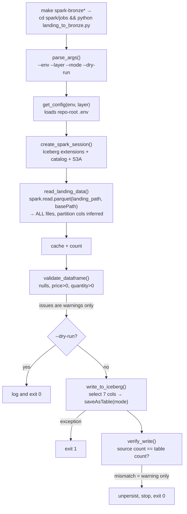

# Critical Execution and Data Flows

Traced through the code at `d30b20f`. File references use `path:line`.

## 1. Ingestion: producer → Kafka → consumer → S3 landing

```mermaid
sequenceDiagram
    autonumber
    participant P as TradesProducer (host)
    participant K as Kafka trades_topic
    participant C as TradesConsumer main thread
    participant FT as flush thread (1s tick)
    participant D as ./data/trades (local disk)
    participant Q as S3Uploader queue (max 1000)
    participant W as 4 upload workers
    participant S3 as Floci S3 landing-bucket

    P->>P: generate() random-walk trade, trade_id=uuid4
    P->>P: transform_record() sets ingestion_timestamp
    P->>K: produce(key=symbol, value=Avro schemaless)
    Note over P: maybe re-send: duplicate / correction / older version
    C->>K: poll(1s)
    C->>C: deserialize, then buffer[date=…/symbol=…].append
    C->>C: track max offset per (topic, partition)
    FT->>FT: _should_flush(): ≥ FLUSH_INTERVAL_SECONDS or ≥ MAX_BUFFER_SIZE
    FT->>D: process_batch(): write .part-….parquet.tmp, then rename
    FT->>Q: queue_upload() (5s put timeout)
    alt queue full
        FT->>S3: synchronous upload_file() (blocks flush; an error re-buffers the whole snapshot)
    end
    FT->>K: commit(offset+1) synchronously
    W->>S3: upload_file() (boto3 adaptive retries)
    alt all attempts fail
        W->>Q: re-queue (up to MAX_UPLOAD_RETRIES=3)
        Note over W: then give up, file kept locally
    end
```

### Producer (`producers/src/trades.py`)

1. `main()` (`trades.py:185`) builds a `ProducerConfig` from `KAFKA_BOOTSTRAP_SERVERS`,
   `TRADES_TOPIC` and `TRADES_SCHEMA_PATH`, then calls `produce_batch_with_test_events`
   with `TRADE_COUNT` (default 10 000) and `TRADE_DELAY` (default 0.02 s, about 50 trades/s).
   `ProducerConfig.from_env()` exists but is **not** used.
2. For each trade: `generate()` → `send()` → `send_with_test_events()` (`trades.py:103`).
   Each base trade can trigger up to three extra messages:
   - **duplicate** (5%): the same record re-sent. `transform_record` mutates
     `ingestion_timestamp` in place, so the duplicate differs only in that field.
   - **correction** (5%): same `trade_id`, price ±0.50, `event_timestamp` +1–5000 ms.
   - **older version** (2%): same `trade_id`, `event_timestamp` −10 s, new `ingestion_timestamp`.

   Separately, `generate()` backdates 2% of base trades by 1–120 s (a late event with a
   unique `trade_id`).
3. `BaseProducer.send()` (`base.py:160`) serialises with `fastavro.schemaless_writer`
   (no schema ID or header in the payload) and produces with `key=symbol`. On `BufferError`
   it polls once and retries once.
4. Callbacks are polled every 100 *base* trades (up to about 400 messages including test events), and a final `flush(10s)` runs at the end.
   Failures only increment `stats.messages_failed` and are logged.

### Kafka

- `init-kafka` creates `trades_topic` with 3 partitions and RF 1 (`docker-compose.yml`).
  `KAFKA_AUTO_CREATE_TOPICS_ENABLE=true`, so producing before `init-kafka` runs would
  auto-create the topic with broker defaults. **(inferred)**
- Keying by symbol gives per-symbol ordering. With 5 symbols over 3 partitions, at least
  one partition carries two or more symbols.

### Consumer (`consumers/src/`)

1. `trades.main()` (`trades.py:152`) builds the config. If `S3_BUCKET` is set, it creates an
   `S3Uploader` and runs **one** `head_bucket` check at construction (`trades.py:73`). If the bucket is missing or
   credentials are rejected (`ClientError`/`NoCredentialsError`), S3 is disabled for the lifetime of the process. The container does not crash,
   so `restart: unless-stopped` will not retry. If Floci is *unreachable*, `EndpointConnectionError`
   escapes `check_connection`, the process crashes, and Docker restarts it.
2. `BaseConsumer.start()` (`base.py:245`) subscribes, starts a daemon flush thread, and polls
   in the main thread. Any Kafka error other than partition EOF is raised, and `finally` calls
   `stop()`.
3. `_handle_message()` (`base.py:228`) deserialises, buffers under
   `get_partition_keys()`, which returns `date=YYYY-MM-DD` (from **`event_timestamp`**, UTC) and
   `symbol=…`, and records the max offset per partition. **Deserialisation errors are logged and
   the message is skipped.** Its offset is not tracked, but a later message's offset on the
   same partition will be committed past it. The bad message is effectively dropped.
4. `flush()` (`base.py:171`) swaps out the buffer and pending offsets under the lock, calls
   `process_batch()` for each partition key, then commits offsets **synchronously**.
   - On any exception, *all* snapshot records are re-buffered, including partitions already
     written to disk. A retry can therefore write duplicate files. This is acceptable under
     at-least-once.
5. `TradesConsumer.process_batch()` (`trades.py:88`) writes
   `<output_dir>/date=…/symbol=…/part-<epoch_ms>-<uuid8>.parquet` through a hidden `.tmp`
   file and `rename`. It uses Snappy, row groups of 10 000 and no dictionary encoding,
   then queues the S3 upload.
6. `S3Uploader` (`uploaders/s3.py`) builds the key as `<S3_PREFIX>/<path relative to
   output_dir>`, uses path-style addressing when an endpoint is set, and boto3 `adaptive`
   retries (3), plus up to 3 re-queues in the async path. `upload_file`'s own 3-attempt loop catches
   only `ClientError`, but boto3 re-raises upload failures as `S3UploadFailedError`, and connection
   errors aren't `ClientError` either. The first failure therefore escapes the loop (verified
   against boto3 1.28.0). That gives about 12 attempts per file in the async path (K8). In the
   **sync fallback** the exception propagates into `flush()`, which re-buffers the whole snapshot,
   rewrites already-written files (duplicates), and skips the commit until the next flush succeeds.

### Delivery semantics (important)

- **Kafka → local disk: at-least-once.** Offsets are committed only after `process_batch`
  returns for every partition in the snapshot.
- **Kafka → S3: not guaranteed.** Offsets are committed once the local file is written and
  the upload is *queued*, not when it completes. If uploads ultimately fail, or the process
  dies with a non-empty queue, the file exists only in `./data/trades`. Kafka will not
  redeliver those records. No reconciliation or re-upload tool exists.
- `DELETE_LOCAL_AFTER_UPLOAD=false` (default) keeps local copies, which is the only recovery
  path today.
- Deduplication is intentionally deferred downstream (see [decisions.md](decisions.md)).

### Shutdown

`setup_signal_handlers` makes SIGINT/SIGTERM call `consumer.stop()`. That flushes, closes the
Kafka consumer, and (in `TradesConsumer.stop`) waits up to 60 s for uploads. When control
returns to `start()`, its `finally` calls `stop()` a second time. **(inferred)** On that
second call, `wait_for_uploads()` puts sentinels into a queue with no live workers and may
wait its full 60 s timeout. Docker's default 10 s stop grace period would then SIGKILL the
container. Data is already flushed by the first call, so the impact is a slow, unclean exit.

## 2. Batch: S3 landing → Iceberg (Spark)



Environment matrix (`spark/jobs/config.py:get_config`):

| | `--env local` | `--env floci` |
|---|---|---|
| Landing source | `s3a://$S3_BUCKET/trades/` on **real AWS** (`s3.<region>.amazonaws.com`) | `s3a://$FLOCI_BUCKET/trades/` (default `landing-bucket`) on `http://localhost:4566` |
| Catalog | Iceberg `hadoop` catalog named `local` | Iceberg `GlueCatalog` named `glue_catalog` (Glue endpoint = Floci) |
| Table | `local.default.raw_trades` (**`--layer` ignored**) | `glue_catalog.iceberg_<layer>.<table>` from `LAYER_CONFIG` |
| Warehouse | `spark/warehouse/` (filesystem) | `s3a://$FLOCI_WAREHOUSE_BUCKET/<layer>` (default `iceberg-warehouse`) |
| Credentials | `AWS_ACCESS_KEY_ID`/`AWS_SECRET_ACCESS_KEY` from `.env` | hardcoded emulator creds `test`/`test` |

Behaviour to be aware of. Details are in [known-issues.md](known-issues.md).

- Every run reads **the entire landing prefix**. There is no watermark. `--mode append`
  re-appends everything, and `verify_write` will then warn about a count mismatch.
- `saveAsTable` is called without `partitionedBy`. A table first created by the job is
  **unpartitioned**. The notebook creates its table `PARTITIONED BY (date, symbol)`, but it
  uses a different warehouse (`<repo>/warehouse`).
- `--layer silver|gold` writes the same raw bronze rows into the silver/gold tables. No
  transformation code exists yet.
- The landing path hardcodes the `trades/` prefix and does not read `S3_PREFIX`.

## 3. Failure paths (summary)

| Failure | What happens | Recovery today |
|---|---|---|
| Kafka down at consumer start | `depends_on: service_healthy` delays start. Mid-run errors other than EOF raise, `stop()` runs, the container restarts (`unless-stopped`). | Automatic restart. Uncommitted offsets are replayed. |
| Landing bucket missing at consumer start | `check_connection` fails, and S3 uploads are disabled until restart. Parquet is still written locally. | `make create-bucket`, then `docker restart trade-consumer`. Files written meanwhile are **not** back-filled. |
| Floci S3 unavailable mid-run | Async: boto3 retries, re-queue ×3, then the file is kept locally (`Upload failed for … file kept locally`). With a full queue, the sync fallback raises into `flush()`, which re-buffers and rewrites the snapshot (duplicate local files) and delays commits. | Manual re-upload from `./data/trades` (no tool). |
| Bad Avro message | Logged and skipped. A later offset on the partition is committed past it. | None. The message is effectively lost. |
| Consumer crash before flush | Buffer is lost. Offsets were not committed, so Kafka replays the records. | Automatic. Duplicates are possible. |
| Spark validation failure | Warning only (bronze accepts raw data). | n/a |
| Spark write failure | Logged, exit 1. Iceberg commits are atomic, so the table is unchanged. **(inferred)** | Re-run. |
