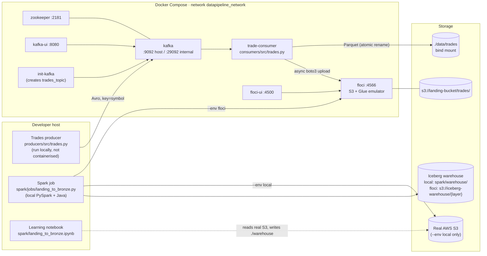

# System Overview

> Verified against the code at commit `d30b20f` (2026-10-11). Statements marked
> **(inferred)** are reasonable readings of the code that have not been confirmed
> by running the full stack; **(unknown)** marks open questions.

## Purpose

A local, containerised **financial trade-data pipeline** used to build and learn a
lakehouse-style architecture. Synthetic trades for five symbols are streamed through
Kafka, landed as Parquet in an S3 bucket, and then batch-loaded by Spark into Apache
Iceberg tables organised as medallion layers (bronze → silver → gold).

The producer deliberately injects duplicates, price corrections and late events so the
downstream layers have realistic data-quality problems to solve. Raw data is never
cleaned before it lands; deduplication is planned for the silver layer (not yet built).

It is **not** a low-latency trading system, and there is no production deployment:
everything runs on a developer machine via Docker Compose, with the
[Floci](https://floci.io/aws/) AWS emulator standing in for S3 and Glue.

## Status at a glance

| Stage | Status | Code |
|---|---|---|
| Synthetic trade producer | Implemented | `producers/src/trades.py` |
| Kafka (single broker, `trades_topic`, 3 partitions) | Implemented | `docker-compose.yml` |
| Kafka → Parquet → S3 landing consumer | Implemented | `consumers/src/` |
| Landing → Iceberg **bronze** Spark job | Implemented (full-refresh only; see [known issues](known-issues.md)) | `spark/jobs/landing_to_bronze.py` |
| Bronze → **silver** (dedup) job | **Not implemented**. The `spark-silver-floci` Make target runs the bronze job against the silver table. | n/a |
| **Gold** aggregates | **Not implemented**. Same placeholder behaviour. | n/a |
| Orchestration / scheduling | None (Airflow archived in `1d83916`) | n/a |
| Automated tests / CI | None | n/a |

## Components

| Component | Responsibility | Key files |
|---|---|---|
| **Producer** | Random-walk trade generator; Avro schemaless serialisation; injects duplicate/correction/late events; keys by `symbol`. | `producers/src/base.py` (`BaseProducer`), `producers/src/trades.py` |
| **Kafka** | Single-broker Confluent 7.5 cluster; topic `trades_topic` (3 partitions, RF 1) created by `init-kafka`; auto-create also enabled. | `docker-compose.yml` |
| **Consumer** | Polls Kafka, buffers by `date=/symbol=`, writes Snappy Parquet, commits offsets manually, queues S3 uploads. | `consumers/src/base.py` (`BaseConsumer`), `consumers/src/trades.py`, `consumers/src/uploaders/s3.py` |
| **Floci** | Local emulator for S3 (landing + warehouse buckets) and Glue (Iceberg catalog). Persists to `./floci-data` in `hybrid` mode by default. | `docker-compose.yml`, `Makefile` floci targets |
| **Spark job** | Reads all landing Parquet, validates (non-blocking), writes an Iceberg table, verifies row counts. | `spark/jobs/{config,utils,landing_to_bronze}.py` |
| **Schema** | Avro record `com.datapipeline.trades.Trade`, the single declared contract. | `configs/schemas/trade_schema.avsc` |
| **Utilities** | `scripts/check_parquet.py` inspects local landing Parquet with pyarrow and pandas. | `scripts/` |

Non-pipeline content: `learning/` holds a pandas practice notebook and CSVs. Nothing in
the pipeline imports it.

## Boundaries and external dependencies

- **Container boundary.** Only the consumer is containerised. The producer and Spark
  run on the host and reach Kafka on `localhost:9092` and Floci on `localhost:4566`.
  Inside Compose, services use `kafka:29092` and `http://floci:4566`.
- **Real AWS touchpoints.** Two paths can reach real AWS. Spark `--env local` reads a real
  S3 bucket using `.env` credentials. The host `aws` CLI in `make setup-floci-iceberg` and
  `make verify-floci-iceberg` has no `--endpoint-url`, so it talks to whatever
  `AWS_ENDPOINT_URL` is exported in your shell. See [development.md](development.md#safety-real-aws-vs-floci).
- **Maven dependencies.** Spark downloads Iceberg/Hadoop-AWS JARs at session start via
  `spark.jars.packages` (`spark/jobs/config.py`, `SparkConfig.packages`). This needs network
  access on the first run.
- **Unpinned images.** `floci/floci`, `floci/floci-ui` and `provectuslabs/kafka-ui` use `:latest`.

## Where to go next

- [data-flows.md](data-flows.md): end-to-end ingestion and Spark flows, delivery
  semantics, failure paths.
- [data-model.md](data-model.md): schemas, storage layouts, table names, config contract.
- [decisions.md](decisions.md): observed design decisions and their stated or inferred
  rationale.
- [development.md](development.md): local setup, commands, validation, safety notes.
- [known-issues.md](known-issues.md): verified bugs, technical debt, documentation drift.
